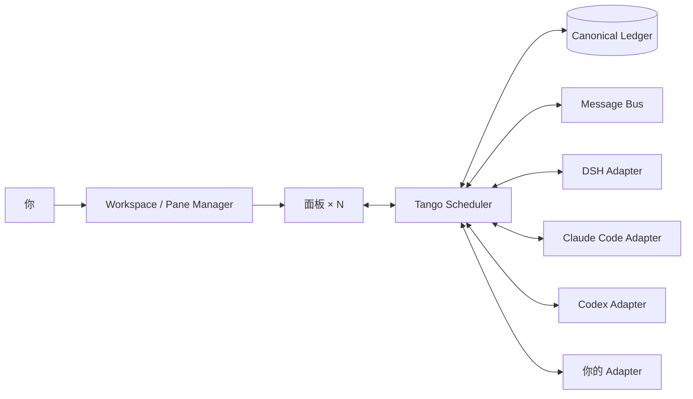

<div align="center">

# Tango

**同一个对话，任意 agent 都能接。**
**One conversation, any agent.**

让你用 Claude Code、Codex、DSH 或别的 agent 时，感觉像在用同一个 agent。

[](#路线图)
[](LICENSE)
[](#)
[](https://github.com/deepseek-ai/deepseek-harness)
[](CONTRIBUTING.md)

</div>

> **状态：设计阶段。** 仓库里目前只有设计与协议草案，尚不可安装。  
> 如果你想让自己的 agent 接入 Tango，欢迎从 [Adapter 提案](CONTRIBUTING.md#提案一个-adapter) 开始。

Tango 是一个 DSH 桌面端插件：把 DSH 和 Claude Code、Codex 等原生 agent 放进同一个面板工作区。面板可以拖动、缩放、分屏、开标签页、增删，数量不限，也可以拖出成独立的系统窗口。

## 一分钟看懂

| 你想要 | Tango 给你 |
| --- | --- |
| 一直用同一个 agent | **共舞**：一条会话，谁都能接着答 |
| 保留各自的习惯 | **独舞**：原生会话、工具、权限都不动 |
| 让几个 agent 协作 | **独舞**：消息总线，互相派活 |
| 想要自己的布局 | **多面板工作区**：拖动、缩放、分屏、标签页 |
| 想要多块屏幕 | **任意面板可拖出成独立系统窗口** |
| 接入别的 agent | **Adapter API**：自己写，或等社区适配 |

## 为什么是 Tango

每个人都有自己的习惯。有人离不开 Codex 的某个工作流，有人把 Claude Code 的 hooks 和 CLAUDE.md 用出了肌肉记忆，有人喜欢 DSH 的原生体验和插件生态。每个 agent 也都有自己的长处：有的擅长长任务，有的擅长终端操作，有的接入了你离不开的模型或工具。

Tango 不要求迁移，也不要求你换掉习惯。它让不同的 agent 共用一条对话，让你感觉始终在跟同一个 agent 说话：

- 想合在一起，就**共舞**：一条会话，轮流领舞。
- 想各干各的，就**独舞**：每个面板一个原生 agent，随时对话。

## 两种模式

### 共舞 / Unified

- 参与共舞的面板共用一份唯一会话记录（canonical history）。
- 每个回合独立选择执行者：DSH、Claude Code、Codex，或后续接入的其他 agent。
- 切回某个 agent 时，只补交它离开期间的已完成回合和工作记录（改过哪些文件、跑过哪些命令），不重放全量历史。
- 每个 agent 仍保留自己的原生会话、工具、权限模式和项目指令（CLAUDE.md / AGENTS.md）。
- 组内任意面板都可以主动发起，由中立调度器仲裁，不是一边指挥一边执行。

### 独舞 / Solo

- 每个 agent 在自己的面板里独立运行，上下文互不污染。
- 通过本地消息总线按名字互发消息；对方忙时消息排队。
- 你可以随时切到任意面板接管。
- 适合“让 Codex 审一下 Claude 的改动”“让 DSH 去查资料，CC 继续写代码”这类协作。

## 工作区

不是一个固定的左右分屏，而是一个可以自由拼接的平铺工作区。每个面板可以是一个 agent、一个普通终端，或一个只读的 Conductor。

### 一个面板

```text
┌─ Claude Code ────────────── 共舞 ── [□] [x] ┐
│  Opus · high effort        running 00:42    │
├─────────────────────────────────────────────┤
│                                             │
│   ... 对话 / 工具调用 / 终端输出 ...        │
│                                             │
├─────────────────────────────────────────────┤
│  > 输入，或点另一块面板接棒                 │
└─────────────────────────────────────────────┘
```

- **头部**：agent、模型 / harness、共舞或独舞、运行状态、最大化 / 分屏 / 拖出 / 关闭。
- **中间**：对话、工具活动或真实终端输出。
- **底部**：输入框或状态栏。共舞时，非当前执行者的输入框显示「等待接棒」。

### 布局

**两块，最常用：**

```text
┌──────────────────────────────┬──────────────────────────────┐
│  DSH                         │  Claude Code                 │
│                              │                              │
│                              │                              │
└──────────────────────────────┴──────────────────────────────┘
```

**四块，像 Windows 平铺：**

```text
┌──────────────────────────────┬──────────────────────────────┐
│  DSH                         │  Claude Code                 │
│                              │                              │
├──────────────────────────────┼──────────────────────────────┤
│  Codex                       │  终端 / 其他 agent           │
│                              │                              │
└──────────────────────────────┴──────────────────────────────┘
```

**一大三小：**

```text
┌──────────────────────────────┬──────────────────────────────┐
│                              │  Claude Code                 │
│                              ├──────────────────────────────┤
│  DSH                         │  Codex                       │
│                              ├──────────────────────────────┤
│                              │  终端                        │
└──────────────────────────────┴──────────────────────────────┘
```

**一个窗格里开标签页：**

```text
┌─ 终端 ───────────────────────────────────┐
│ [ Claude ] [ Codex ] [ shell ]        +  │
├──────────────────────────────────────────┤
│                                          │
│  ...                                     │
│                                          │
└──────────────────────────────────────────┘
```

**拖出成独立系统窗口，放到第二块屏幕：**

```text
┌─ 主窗口 ─────────────────────┐   ┌─ 独立窗口 ──────────────┐
│  DSH          │  Codex       │   │  Claude Code            │
│               │              │   │                         │
└───────────────┴──────────────┘   └─────────────────────────┘
```

布局会按工作区保存；下次打开还是你上次的样子。

### 交互

- 拖分隔线：调整大小。
- 拖面板头部：换位置、重新停靠。
- 双击头部：最大化；再双击还原。
- 分屏按钮：向右或向下拆分。
- 面板可以收起、关闭、重新打开。
- 加面板时选：DSH / Claude Code / Codex / 普通终端。
- 一个窗格里可以开标签页，多个会话共用一个窗格。
- 任意面板可以拖出成独立系统窗口，也可以再拖回来。
- 可以把几个面板连成一组，组内共舞，组外独舞。

### 共舞时面板怎么表现

- 同一组的面板用同一种边框或角标，表示它们共享一条会话。
- 当前回合由谁执行，头部亮一个「接力棒」图标。
- 其他面板只读显示这轮内容，并标注 `executed by Claude Code`。
- 点另一块面板的「接棒」，下一轮就换它执行。
- 切换时短暂显示「正在补交离开期间的记录」。
- 可以额外开一个只读的 **Conductor 面板**：看整条 canonical timeline，谁在第几轮执行、交接了什么。

### 独舞时面板怎么表现

- 每个面板完全独立，边框各是各的颜色。
- 面板之间用「发给谁」按钮或拖拽卡片来传话。
- 对方忙时，消息显示为排队中的小卡片。
- 你随时点进任意面板接管。

### 混用

同一个工作区里，可以同时有共舞组和独舞面板。比如 DSH + Claude Code 共舞，旁边 Codex 和终端各自独舞。

更细的交互、状态和持久化定义见 [docs/workspace.md](docs/workspace.md)。

## 支持的 agent

| Agent | 共舞 | 独舞 | 接入方式 | 状态 |
| --- | --- | --- | --- | --- |
| DSH | 计划中 | 计划中 | 内置 session API | Phase 2 |
| Claude Code | 计划中 | 计划中 | stream-json / Agent SDK | Phase 2 |
| Codex | 计划中 | 计划中 | app-server JSON-RPC | Phase 3 |
| Gemini CLI | 待社区适配 | 计划中 | MCP / ACP | Phase 3 |
| Kimi Code | 待社区适配 | 计划中 | ACP | Phase 3 |
| 你的 agent | 欢迎 | 欢迎 | [Adapter API](docs/adapter-spec.md) | 征集中 |

## 架构



- **Workspace / Pane Manager** — 平铺、拖动、缩放、分屏、标签页、拖出独立窗口、面板编组、布局持久化。
- **Tango 桌面插件** — DSH `desktop` profile 里的工作区入口、模式开关、面板菜单。
- **Scheduler / Broker** — 中立调度层：唯一会话账本（canonical ledger）、回合仲裁、单写者、增量交接（handoff）。
- **Adapters** — 每个 agent 一个适配器，Tango 不关心它内部怎么实现。
- **Message Bus** — 独舞模式的消息通道，MCP 工具 + 本地共享目录。
- **Storage** — 本地 SQLite / JSONL，放在 `~/.dsh/tango/`。

一个关键点：共舞模式下，参与共舞的面板不是纯伪终端（PTY），而是由 adapter 驱动、调度层能读到每一轮的终端视图；独舞模式才使用真 PTY。

## 设计原则

1. **像在用同一个 agent** — 用户感觉是在跟一个 agent 说话，不是在管理一堆进程。
2. **不强迫迁移** — 原生会话、工具、权限、项目指令都保留。
3. **单一账本** — 共舞模式只有一份唯一会话记录，避免各记一套。
4. **谁都能发起** — 任意面板都可以开启回合，由中立调度器仲裁。
5. **增量交接** — 切回时只补离开期间的增量，不重复注入全量。
6. **可分离** — 独舞模式不共享上下文，只共享消息通道。
7. **本地优先** — 会话、消息、账本都在本机，默认不上云。
8. **Adapter 优先** — 新 agent 通过 adapter 接入，而不是改 Tango 内核。
9. **布局自由** — 面板数量、排列、停靠、是否独立成窗口，都由用户决定。

## 生态

Tango 不靠往内核里塞更多 agent 来扩展，而是让**任何人都能把自己的 agent 接进来**。

### Adapter 优先

一个 adapter 只需要实现四件事：

| 能力 | 说明 |
| --- | --- |
| `detect()` | 找到 CLI、版本、登录状态 |
| `start()` / `resume()` | 启动或恢复原生会话 |
| `send()` / `stream()` | 发送一轮，流式返回正文与工具活动 |
| `interrupt()` | 取消当前回合 |

完整的接口、消息格式与一致性测试见 [docs/adapter-spec.md](docs/adapter-spec.md)。

### 一个 adapter 长什么样

```json
{
  "id": "claude-code",
  "name": "Claude Code",
  "modes": ["unified", "solo"],
  "transport": "stream-json",
  "entry": "./adapter.mjs"
}
```

### 接入一个新 agent

1. 用 [Adapter 提案模板](.github/ISSUE_TEMPLATE/adapter-proposal.md) 开 issue，说明 agent、传输方式、登录方式和平台。
2. 按 [adapter 协议](docs/adapter-spec.md) 实现最小可用 adapter。
3. 跑一致性测试（计划中），提交 PR；通过后进入 adapter 列表。

### 社区方向

- **Adapter 注册表**：官方维护一份经过验证的 adapter 列表。
- **插件市场**：Tango 作为 DSH 插件上架，后续提供一键安装。
- **本地优先**：不上传会话，不做云端托管，adapter 也遵守这条边界。
- **文档与翻译**：中英文优先，欢迎其他语言。

## 非目标

- 不做模型聚合器或 API 网关。
- 不替代 DSH / Claude Code / Codex 的原生能力。
- 不把会话上传到云端。
- 不强迫用户迁移，也不要求统一工作流。

## 路线图

- [ ] **Phase 0 — 设计与协议**（当前）
  - canonical message schema、handoff 协议、adapter 接口、工作区交互
- [ ] **Phase 1 — 多面板工作区 + 独舞模式**
  - 拖动、缩放、分屏、标签页、拖出独立窗口、面板编组、布局持久化
  - 真 PTY、消息总线、人随时接管
- [ ] **Phase 2 — 共舞 MVP**
  - DSH + Claude Code、唯一会话账本、增量交接
- [ ] **Phase 3 — 更多 adapter**
  - Codex、Gemini CLI、Kimi Code，完善回合仲裁与工作记录
- [ ] **Phase 4 — 生态与分发**
  - adapter 注册表、插件市场、安装器、文档与测试

## 快速开始

**目前尚不可安装。** 规划中的安装方式：

```bash
# 规划中，尚未可用
dsh plugin --profile desktop add dsh-tango
```

想参与设计或提前适配自己的 agent，请先看 [CONTRIBUTING.md](CONTRIBUTING.md)。

## FAQ

**Tango 是另一个聊天客户端吗？**  
不是。它是 DSH 桌面端的一个插件，加一层中立的调度器；聊天界面仍然是 DSH 和你熟悉的终端。

**会取代 DSH / Claude Code / Codex 吗？**  
不会。每个 agent 仍然按自己的方式运行，Tango 只负责会话、切换和消息。

**需要把会话上传到云端吗？**  
不需要。默认全部在本机，adapter 也遵守本地优先。

**我能接入自己的 agent 吗？**  
能。只要能启动一个进程并通过 stream/stdout 或 MCP/ACP 通信，就可以写 adapter。

**面板只能左右两个吗？**  
不是。可以平铺成任意数量，拖动、缩放、分屏、开标签页，也可以把任意面板拖出成独立系统窗口，放到第二块屏幕。共舞和独舞可以混用。

**Windows 能用吗？**  
计划支持 Windows、macOS、Linux。DSH Desktop 本身支持 Windows。

**为什么叫 Tango？**  
见下方 [名字](#名字)。

## 参与贡献

设计阶段最重要的是**先讨论，再实现**。欢迎：

- 提出新的 adapter（Claude Code、Codex、Gemini、Kimi、Aider、OpenCode……）
- 参与调度协议与 handoff 设计
- 做多面板工作区的 UI / UX（平铺、分屏、标签页、拖出窗口）
- 补文档、翻译、测试用例
- 报告你遇到的 agent 兼容性问题

详见 [CONTRIBUTING.md](CONTRIBUTING.md)。

## 名字

Tango 是两个人的舞，但舞池可以站很多人。有时你带，有时我带，但始终是同一支舞。

**共舞时是一支舞，独舞时各跳各的。**

## English

**Tango** makes Claude Code, Codex, DSH and other agents feel like one agent. In **Unified** mode they share a single conversation, and you choose who executes each turn; in **Solo** mode they split into independent peers that can talk to each other. No migration, no re-explaining.

- **Flexible panes** — resize, drag, split, tab, add or remove panes like windows; detach any pane into its own OS window; any number.
- **Unified** — one canonical conversation, per-turn executor switching, delta handoff.
- **Solo** — native sessions stay separate; a local message bus lets them collaborate.
- **Extensible** — bring your own agent through the [adapter API](docs/adapter-spec.md).
- **Local-first** — sessions, messages and ledgers stay on your machine.

Status: design stage. See [CONTRIBUTING.md](CONTRIBUTING.md) to join the adapter ecosystem.

## License

[MIT](LICENSE) © 2026 Tango contributors
