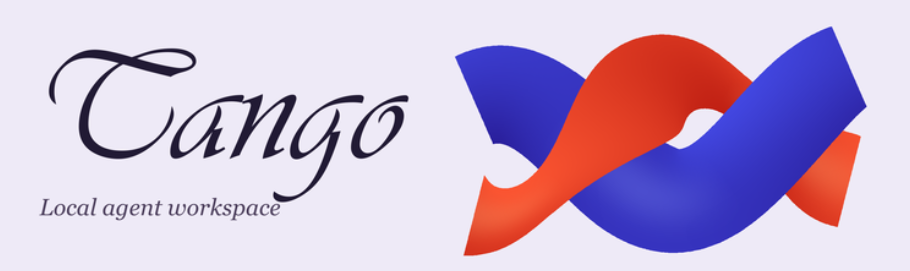

<h1></h1>

**独立的本地 Agent 工作台**

在一个工作台里使用已有的 Agent，让多个 Agent 沿着同一段对话继续工作。

Tango 面向每天和 Agent 一起写代码、查资料、跑测试的人。打开 Tango 后，选择一个项目目录和已接入的 Agent，就可以在工作区里开始任务。你可以让一个 Agent 独立完成，也可以把任务交给另一个 Agent 继续。任务目标、对话和工作记录随任务保存在 Tango，接手时能看到已经做了什么、还有哪些事待处理。

**项目状态**　设计阶段。[工作区规格](docs/workspace.md)和 [Adapter 协议](docs/adapter-spec.md)是实现草案。目前尚无可运行版本。

## Tango 如何接入 Agent

| 组成 | 职责 |
| --- | --- |
| 工作区 | 管理项目目录、任务列表、对话、工作记录和面板布局。重新打开时，可以从任务记录了解进度并继续。 |
| 会话与交接 | 管理当前执行者、回合状态和任务时间线，向接手的 Agent 提供已有上下文。 |
| Adapter | 连接 Codex、Claude Code、DSH 等已有 Agent，转发指令、会话事件和双方支持的审批或停止操作。 |
| 已接入的 Agent | 使用自己的登录、模型、工具和权限实际执行任务。 |

一个工作区可以只接入一个 Agent，按需添加其他 Agent 参与任务。

## 独舞与共舞

| 模式 | 怎么用 | 对话 |
| --- | --- | --- |
| **独舞 / Solo** | 选一个 Agent 做一个任务。多个任务可以各开一个面板，同时推进。 | 每个任务有独立记录。 |
| **共舞 / Unified** | 给同一个任务添加多个 Agent，按需切换执行者。同一时间由一个 Agent 执行回合。 | 共用一份任务记录，标明每轮由谁执行。 |

以 Codex 和 Claude Code 为例。你在 Tango 里创建「修复导出文件的编码问题」，先用 Codex 修改导出逻辑，再把同一个任务交给 Claude Code 检查改动。Tango 交接相关文件、已跑过的测试和待验证项，并在任务时间线上记录两位 Agent 的回合。

## 工作台

侧栏用于选择项目和任务。主区用于看对话、发指令，并在接入支持时处理 Agent 的审批请求。任务时间线记录执行者、工具结果与交接。一个任务可以关联多个 Agent 面板，切换面板后仍能看到该任务的记录。

工作区的布局设计包含平铺、分屏、标签页和独立窗口。首版从单窗口开始，先把从创建任务到恢复工作的流程做通。详见[工作区规格](docs/workspace.md)。

## 首版范围

1. 打开项目目录，通过第一个 Adapter 连接已安装并登录的 Agent，创建任务。
2. 在面板里发送指令、查看流式输出和可用的工具事件，按接入能力审批或停止。
3. 本地保存任务和对话。重新打开后，通过 Adapter 恢复原生会话，或从任务记录继续。
4. 接入第二个 Agent，验证两者能在同一个任务里交接目标、已完成工作和待办。

外部 Agent 的接入按各自的协议和能力逐项验证。欢迎提案、实现 Adapter 或参与工作台和会话编排开发。 [Adapter 提案模板](.github/ISSUE_TEMPLATE/adapter-proposal.md) · [Adapter 协议](docs/adapter-spec.md) · [贡献指南](CONTRIBUTING.md)

## English

Tango is a standalone, local-first workspace for existing agents such as Codex, Claude Code, and DSH. Adapters connect Tango to each agent's native session. Tango manages tasks, conversation history, and handoffs. Each agent runs the work with its own model, tools, and permissions. Use one agent in Solo mode, or hand off a task between agents in Unified mode while keeping a single conversation and activity record.

Tango is currently in the design stage. [Workspace spec](docs/workspace.md) · [Adapter spec](docs/adapter-spec.md)

## License

[MIT](LICENSE) © 2026 Tango contributors
