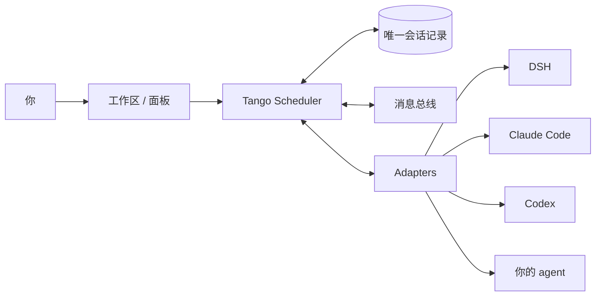

<div align="center">

# Tango

**同一个对话，任意 agent 都能接。**
**One conversation, any agent.**

让你用 Claude Code、Codex、DSH 或别的 agent 时，感觉像在用同一个 agent。

[](#状态与路线图)
[](LICENSE)
[](#)
[](https://github.com/deepseek-ai/deepseek-harness)
[](CONTRIBUTING.md)

</div>

> **状态：设计阶段。** 仓库里目前只有设计与协议草案，尚不可安装。  
> 如果你想让自己的 agent 接入 Tango，欢迎从 [Adapter 提案](CONTRIBUTING.md#提案一个-adapter) 开始。

**TL;DR** — 一个对话，换谁执行都行；不想共享就分开，各自还能互相说话；面板随便摆，也能拖出成独立窗口。

## 它是什么

Tango 是 DSH 桌面端的一个插件：把 DSH、Claude Code、Codex 等 agent 放进同一个面板工作区。它只有两种用法：

- **共舞**：它们共用一条对话，下一回合换谁执行都行。
- **独舞**：它们各自独立，但能互相发消息、派活。

你不用再决定“这轮该用哪个 agent”。你只是在同一个对话里继续，Tango 负责把上下文交给下一个接棒的人。

## 一个具体例子

你在 DSH 面板里说：“把登录改成 JWT。”

1. DSH 改了 auth 中间件，停在测试失败。
2. 你点旁边 Claude Code 面板的「接棒」。
3. Claude Code 不用你复述：它看到 DSH 刚才说了什么、改了哪些文件，直接接着修。
4. 你切回 DSH，DSH 也看得到 Claude Code 的改动。
5. 整条对话仍然只有一份记录，不是两份。

这就是“像一个 agent”。

## 两种模式

| | 共舞 / Unified | 独舞 / Solo |
| --- | --- | --- |
| 上下文 | 共用一条对话 | 各自独立 |
| 谁执行 | 每回合你选，或自动接棒 | 各自跑各自的 |
| 切换 | 随时切，只补增量 | 不切换 |
| 适合 | 一件事，换擅长的 agent 接着做 | 多件事并行，或让 agent 互相派活 |
| 消息 | 不需要额外发消息 | 通过消息总线互发 |

### 共舞怎么工作

- 一份唯一会话记录（canonical history）。
- 每个回合选执行者：DSH、Claude Code、Codex，或后续接入的其他 agent。
- 切回时只补交离开期间的已完成回合和工作记录，不重放全量。
- 每个 agent 仍保留自己的原生会话、工具、权限和项目指令（CLAUDE.md / AGENTS.md）。

### 独舞怎么工作

- 每个 agent 独立会话，上下文互不污染。
- 按名字互发消息；对方忙时消息排队。
- 你可以随时切到任意面板接管。

## 工作区

像 Windows 窗口一样平铺，不是固定左右两栏。

```text
┌──────────────────────────────┬──────────────────────────────┐
│  DSH                         │  Claude Code                 │
│                              │                              │
├──────────────────────────────┼──────────────────────────────┤
│  Codex                       │  终端 / 其他 agent           │
│                              │                              │
└──────────────────────────────┴──────────────────────────────┘
```

- 面板数量不限，可拖动、缩放、分屏、开标签页。
- 任意面板可以拖出成独立系统窗口，放到第二块屏幕。
- 几个面板可以编组共舞，其他面板独舞。
- 布局按工作区保存，下次打开恢复原样。

更细的面板、交互和持久化定义见 [docs/workspace.md](docs/workspace.md)。

## 支持的 agent

| Agent | 共舞 | 独舞 | 接入方式 | 状态 |
| --- | --- | --- | --- | --- |
| DSH | 计划中 | 计划中 | 内置 session API | Phase 2 |
| Claude Code | 计划中 | 计划中 | stream-json / Agent SDK | Phase 2 |
| Codex | 计划中 | 计划中 | app-server JSON-RPC | Phase 3 |
| Gemini CLI | 待社区适配 | 计划中 | MCP / ACP | Phase 3 |
| Kimi Code | 待社区适配 | 计划中 | ACP | Phase 3 |
| 你的 agent | 欢迎 | 欢迎 | [Adapter API](docs/adapter-spec.md) | 征集中 |

## 它不是什么

- 不是模型聚合器，也不是 API 网关。
- 不是新的聊天客户端；界面仍然是 DSH 和你熟悉的终端。
- 不替代 DSH / Claude Code / Codex 的原生能力。
- 不把会话上传到云端。

## 架构



- **Workspace / Pane Manager** — 平铺、拖动、缩放、分屏、标签页、拖出独立窗口、面板编组、布局持久化。
- **Scheduler** — 回合仲裁、增量交接（handoff）、权限与取消。
- **Adapters** — 每个 agent 一个适配器，Tango 不关心它内部怎么实现。
- **Message Bus** — 独舞模式的消息通道。
- **Storage** — 本地 SQLite / JSONL，放在 `~/.dsh/tango/`。

细节见 [adapter 协议](docs/adapter-spec.md) 与 [工作区协议](docs/workspace.md)。

## 生态

Tango 不靠往内核里塞更多 agent 来扩展，而是让**任何人都能把自己的 agent 接进来**。

一个 adapter 只需要实现四件事：

| 能力 | 说明 |
| --- | --- |
| `detect()` | 找到 CLI、版本、登录状态 |
| `start()` / `resume()` | 启动或恢复原生会话 |
| `send()` / `stream()` | 发送一轮，流式返回正文与工具活动 |
| `interrupt()` | 取消当前回合 |

接入步骤：

1. 用 [Adapter 提案模板](.github/ISSUE_TEMPLATE/adapter-proposal.md) 开 issue。
2. 按 [adapter 协议](docs/adapter-spec.md) 实现最小可用 adapter。
3. 跑一致性测试（计划中），提交 PR。

后续会有 adapter 注册表和 DSH 插件市场的一键安装。

## 状态与路线图

- [ ] **Phase 0 — 设计与协议**（当前）
  - canonical message schema、handoff 协议、adapter 接口、工作区交互
- [ ] **Phase 1 — 多面板工作区 + 独舞模式**
  - 拖动、缩放、分屏、标签页、拖出独立窗口、面板编组、布局持久化
  - 真 PTY、消息总线、人随时接管
- [ ] **Phase 2 — 共舞 MVP**
  - DSH + Claude Code、唯一会话账本、增量交接
- [ ] **Phase 3 — 更多 adapter**
  - Codex、Gemini CLI、Kimi Code，完善回合仲裁与工作记录
- [ ] **Phase 4 — 生态与分发**
  - adapter 注册表、插件市场、安装器、文档与测试

## FAQ

**Tango 是另一个聊天客户端吗？**  
不是。它是 DSH 桌面端的一个插件，加一层中立的调度器；聊天界面仍然是 DSH 和你熟悉的终端。

**会取代 DSH / Claude Code / Codex 吗？**  
不会。每个 agent 仍然按自己的方式运行，Tango 只负责会话、切换和消息。

**需要把会话上传到云端吗？**  
不需要。默认全部在本机，adapter 也遵守本地优先。

**面板只能左右两个吗？**  
不是。可以平铺成任意数量，拖动、缩放、分屏、开标签页，也可以把任意面板拖出成独立系统窗口。共舞和独舞可以混用。

**我能接入自己的 agent 吗？**  
能。只要能启动一个进程并通过 stream/stdout 或 MCP/ACP 通信，就可以写 adapter。

**为什么叫 Tango？**  
Tango 是两个人的舞，但舞池可以站很多人。共舞时是一支舞，独舞时各跳各的。

## 参与贡献

设计阶段最重要的是**先讨论，再实现**。欢迎：

- 提出新的 adapter（Claude Code、Codex、Gemini、Kimi、Aider、OpenCode……）
- 参与调度协议与 handoff 设计
- 做多面板工作区的 UI / UX（平铺、分屏、标签页、拖出窗口）
- 补文档、翻译、测试用例
- 报告你遇到的 agent 兼容性问题

详见 [CONTRIBUTING.md](CONTRIBUTING.md)。

## English

**Tango** makes Claude Code, Codex, DSH and other agents feel like one agent.

- **Unified** — one shared conversation; choose who executes each turn; switch anytime, with only the delta handed over.
- **Solo** — native sessions stay separate, with a local message bus for agent-to-agent messages.
- **Flexible panes** — resize, drag, split, tab, add or remove panes like windows; detach any pane into its own OS window.
- **Extensible** — bring your own agent through the [adapter API](docs/adapter-spec.md).

Status: design stage. See [CONTRIBUTING.md](CONTRIBUTING.md) to join the adapter ecosystem.

## License

[MIT](LICENSE) © 2026 Tango contributors
